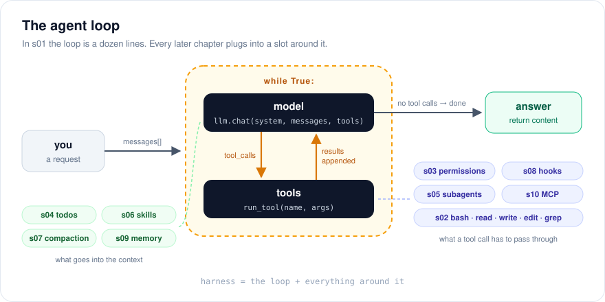

<div align="center">

# 从零手写 Agent Harness

**10 步，从一个空文件写出你自己的 Claude Code。**<br>
纯 Python · 零依赖 · 每一章都能离线运行，不需要 API Key

[**English**](README.md) · [**简体中文**](README.zh-CN.md)

[](https://github.com/Sur1ive/harness-from-scratch/actions/workflows/test.yml)




</div>

---

Claude Code、Codex、Cursor Agent、DeepSeek Harness……你用过的每一个"编程智能体"，
拆开来都是两部分：**模型** + **Harness（驾驭层）**。

模型只负责输出文字。其余的一切都是 harness 干的：循环、工具、权限确认、
待办清单、子智能体、上下文压缩、钩子、记忆文件、MCP……

模型你训练不了，**harness 你完全可以自己写**。这个仓库就从一个空文件开始，
每章只加一个机制。每章都是**一个可以直接运行的完整文件**，在上一章基础上只多一个想法。
到第 10 章，你手里会有一个约 600 行、完整可用的 harness，而且每一行为什么存在你都清楚。

```python
def agent_loop(messages):
    while True:
        reply = llm.chat(system_prompt(), messages, TOOLS)  # 1. 问模型
        messages.append(reply)
        if not reply["tool_calls"]:                          # 2. 不再调用工具 -> 结束
            return reply["content"]
        for call in reply["tool_calls"]:                     # 3. 执行它要的每个工具
            output = run_bash(call["args"]["command"])
            messages.append({"role": "tool", "id": call["id"], "name": call["name"], "content": output})
        # 4. 回到开头：模型看到结果，决定下一步
```

这就是第 1 章。**这个循环就是 agent 本身**，后面 9 章都是往这个循环上插东西。

<p align="center"></p>

## 快速开始

```bash
git clone https://github.com/Sur1ive/harness-from-scratch
cd harness-from-scratch
python agents/s01_agent_loop.py      # 没有 Key？直接进入离线演示，工具是真的在跑
```

不用 `pip install`，有 Python 3.10+ 就行。

没有 API Key 时，每一章都会播放一段**脚本演示**：由一个"假模型"按剧本做决定，
但工具、权限检查、钩子、MCP 服务器全都是真实运行的（在一个临时目录里）。
想接真模型，导出一个 Key 即可：

```bash
export DEEPSEEK_API_KEY=sk-...        # 或 ANTHROPIC_API_KEY、DASHSCOPE_API_KEY ...
python agents/s10_mcp.py
```

## 章节目录

| # | 章节 | 新增内容 | 核心思想 |
|---|------|----------|----------|
| 01 | [Agent 循环](docs/zh/s01-agent-loop.md) · [`代码`](agents/s01_agent_loop.py) | `while` + 一个 `bash` 工具 | Agent 就是一个循环，模型不再要工具时结束 |
| 02 | [工具](docs/zh/s02-tools.md) · [`代码`](agents/s02_tools.py) | 读 · 写 · 改 · glob · grep | 一张分发表；工具出错是"结果"，不是异常 |
| 03 | [权限](docs/zh/s03-permissions.md) · [`代码`](agents/s03_permissions.py) | 拒绝规则，ask / auto / plan 模式 | harness 是最后一道防线；"拒绝"本身就是给模型的反馈 |
| 04 | [待办清单](docs/zh/s04-todo.md) · [`代码`](agents/s04_todo.py) | `todo_write` + 催促提醒 | 逼模型把计划写下来，它就会按计划干活 |
| 05 | [子智能体](docs/zh/s05-subagent.md) · [`代码`](agents/s05_subagent.py) | `task` 工具 | 同一个循环 + 全新的 `messages`：支线任务不污染主上下文 |
| 06 | [技能](docs/zh/s06-skills.md) · [`代码`](agents/s06_skills.py) | `SKILL.md` + `load_skill` | 渐进式披露：提示词里只放目录，正文按需加载 |
| 07 | [上下文压缩](docs/zh/s07-compact.md) · [`代码`](agents/s07_compact.py) | 微压缩 + 摘要 | 有计划地遗忘，同时不让提示词缓存每轮都失效 |
| 08 | [钩子](docs/zh/s08-hooks.md) · [`代码`](agents/s08_hooks.py) | Pre/PostToolUse、Stop、UserPromptSubmit | 提示词是建议，钩子是保证 |
| 09 | [记忆](docs/zh/s09-memory.md) · [`代码`](agents/s09_memory.py) | `AGENTS.md` / `CLAUDE.md` + `remember` | 指令和记忆，不过是 harness 负责加载的文件 |
| 10 | [MCP](docs/zh/s10-mcp.md) · [`代码`](agents/s10_mcp.py) | 60 行 MCP 客户端 + 演示服务器 | 来自其他进程的工具：stdin/stdout 上的 JSON-RPC |
| ★ | [`harness.py`](agents/harness.py) | 斜杠命令、会话保存、`-p` 模式 | 以上全部，打包成日常可用的工具 |

建议按顺序读。每个文件都完整可运行，所以
`diff agents/s04_todo.py agents/s05_subagent.py` 就能看到一章到底加了什么。

## 支持任意模型

一种中立的消息格式，两种线协议，主流服务商全覆盖，全部在
[`agents/llm.py`](agents/llm.py) 里，只用了标准库 `urllib`。

| `HARNESS_PROVIDER` | API Key 环境变量 | 默认模型 |
|---|---|---|
| `deepseek` | `DEEPSEEK_API_KEY` | `deepseek-chat` |
| `qwen`（通义千问） | `DASHSCOPE_API_KEY` | `qwen-plus` |
| `kimi`（月之暗面） | `MOONSHOT_API_KEY` | 需设置 `HARNESS_MODEL` |
| `glm`（智谱） | `ZHIPUAI_API_KEY` | 需设置 `HARNESS_MODEL` |
| `siliconflow`（硅基流动） | `SILICONFLOW_API_KEY` | 需设置 `HARNESS_MODEL` |
| `doubao`（豆包 / 火山方舟） | `ARK_API_KEY` | 需设置 `HARNESS_MODEL` |
| `gemini` | `GEMINI_API_KEY` | 需设置 `HARNESS_MODEL` |
| `anthropic` | `ANTHROPIC_API_KEY` | `claude-opus-5-5` |
| `openrouter` | `OPENROUTER_API_KEY` | 需设置 `HARNESS_MODEL` |
| `openai` | `OPENAI_API_KEY` | 需设置 `HARNESS_MODEL` |
| `ollama`（本地） | 无 | 需设置 `HARNESS_MODEL` |
| 任意 OpenAI 兼容服务（vLLM、LM Studio、one-api…） | `HARNESS_API_KEY` | `HARNESS_BASE_URL=http://...` + `HARNESS_MODEL` |

不指定 provider 时，会用环境里找到的第一个 Key；一个都没有，就进入离线演示。

## 真的拿来用

```bash
cd ~/你的项目
python ~/harness-from-scratch/agents/harness.py            # 交互模式
python ~/harness-from-scratch/agents/harness.py --resume   # 接着上次的会话
HARNESS_PERMISSION=auto python ~/harness-from-scratch/agents/harness.py -p "把挂掉的测试修好"
```

内置命令：`/tools` `/skills` `/todos` `/memory` `/mode plan` `/compact` `/clear` `/exit`。
它读取的文件和其他 agent 一样：`AGENTS.md`、`CLAUDE.md`、`.claude/skills/*/SKILL.md`、`.mcp.json`。
每轮对话后自动保存到 `.harness/`。

它刻意保持小巧：没有流式输出、没有沙箱、没有 IDE 集成。正经干活请继续用成熟的产品；
它存在的意义，是让那些产品在你眼里**不再是魔法**。

## 这些机制你在哪见过

| 机制 | 章节 | 在 Claude Code 里 |
|---|---|---|
| 工具循环 | s01 | 每一轮对话的核心 |
| 专用文件工具 | s02 | `Read`、`Write`、`Edit`、`Glob`、`Grep` |
| 权限模式 | s03 | 询问 / 自动接受编辑 / plan 模式，`permissions.deny` |
| 待办清单 | s04 | todo / task 列表工具 |
| 子智能体 | s05 | subagents、自定义 agent |
| 技能 | s06 | `SKILL.md` 技能 |
| 上下文压缩 | s07 | 自动压缩、`/compact` |
| 钩子 | s08 | `PreToolUse`、`PostToolUse`、`Stop`、`UserPromptSubmit`（退出码 2 = 拦截） |
| 记忆 | s09 | `CLAUDE.md` 文件 |
| MCP | s10 | `.mcp.json`、`mcp__server__tool` 命名 |

## 本仓库的设计原则

- **一章一个文件，永远能跑。** 没有框架要学，章节之间互不导入。
- **零依赖。** 读者应该能读完全部代码，包括 `llm.py`。
- **历史只追加。** 只往后加消息，从不改旧消息（s07 是唯一例外，并解释了为什么），
  因为在真实 harness 里，这是让提示词缓存保持命中的关键。
- **错误也是工具结果。** 命令失败、权限被拒、钩子拦截，统统以文字形式回给模型，让它自己调整。
- **测试完全离线。** `python tests/test_harness.py` 会跑完每一章的演示，并用一个假 HTTP 服务器校验两种线协议。

## 常见问题

**为什么用 Python 不用 TypeScript？** 不需要构建步骤，读的人最多。思想可以 1:1 移植，
把 s01 翻译成你熟悉的语言是个不错的练习。

**和其他"自己写 agent"的教程有什么不同？** 三点：开箱即可离线运行（脚本演示）；
把权限、钩子、压缩、MCP 这些 *harness* 机制当成主角，而不是附录；
不绑定厂商，DeepSeek、通义千问、Kimi、智谱都是一等公民。

**假模型能干活吗？** 不能。它只是照剧本演，让你没有 Key 也能看清机制。真要干活请配置 API Key。

**Windows 能用吗？** 文件类工具都能用；`bash` 工具调用的是系统 shell（Windows 上是 `cmd`），推荐用 WSL。

## 参与贡献

欢迎翻译、补充练习题、新章节、修 bug。适合作为下一章的主题：流式输出、沙箱、
用 git worktree 跑并行 agent、多智能体团队、评测（evals）。
请保持上面的原则：一个能跑的文件、零依赖、测试离线。

如果它帮你看懂了 coding agent 的工作原理，点个 ⭐ 能让更多人看到它。

## 许可证

[MIT](LICENSE)
